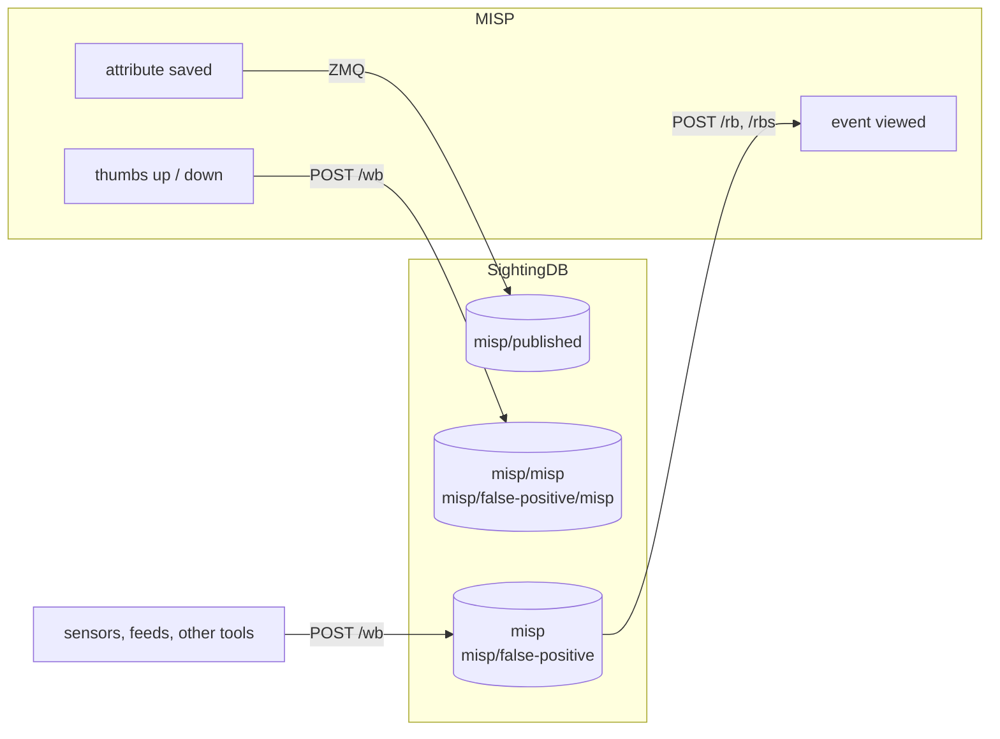

# STIX and MISP

Chapter 1 made the claim that SightingDB stores exactly what a STIX sighting
is. This is the chapter where that pays.

## Exporting STIX 2.1

```bash
curl -H 'Authorization: changeme' \
  'http://localhost:9999/stix/feeds/misp/ips' > bundle.json
```

A namespace becomes a bundle shaped after the OASIS *Sighting of an Indicator*
example: for each value an `indicator` carrying the pattern, and a `sighting`
that refers to it with the count and the window.

```json
{"type":"bundle","id":"bundle--...","objects":[
  {"type":"identity","id":"identity--...","name":"SightingDB", ...},
  {"type":"indicator","id":"indicator--...",
   "pattern":"[ipv4-addr:value = '198.51.100.23']","pattern_type":"stix",
   "object_marking_refs":["marking-definition--..."], ...},
  {"type":"sighting","id":"sighting--...",
   "count":5,"first_seen":"...","last_seen":"...",
   "sighting_of_ref":"indicator--...",
   "where_sighted_refs":["identity--..."],
   "x_sightingdb_namespace":"feeds/misp/ips"},
  {"type":"marking-definition","name":"TLP:AMBER", ...}]}
```

The namespace travels as `x_sightingdb_namespace`, which is a custom property
and so carries the `x_` prefix the specification requires.

### Ids are derived, not minted

**Minting** an id is creating a fresh one. A STIX identifier is the object's
type, two dashes, and a UUID:

```text
indicator--9299f726-ce06-492e-8472-2b52ccb53191
```

Normally that UUID is a **version 4** — random. Minting one takes nothing but
a source of randomness, which is why it is the default: no agreement is
needed, and two parties will never collide. The cost is that it is new every
time. Export the same value twice and you get two unrelated ids, and nothing
downstream can tell they describe the same thing.

A **version 5** UUID is the other kind. It is a hash of two inputs:

- a **namespace UUID**, chosen once and kept forever, and
- a **name** — any string, as long as you can produce the same one again.

Same two inputs, same UUID, on any machine, in any language, for ever. So
"what it takes to mint" is really the question of which of those two you are
doing: with v4, a random number; with v5, a namespace you have fixed and a
name you can reconstruct.

SightingDB uses v5 everywhere, with a namespace of its own:

```text
3ef11775-6174-4718-92bf-16705b732650
```

and these names:

| Object | The name that is hashed |
| --- | --- |
| indicator | `indicator:<observable type>:<value>` |
| sighting | `sighting:<namespace>:<observable type>:<value>` |
| identity | `identity:<name>` |
| bundle | `bundle:<namespaces, comma separated>` |

Which means you can mint the same ids yourself, without this server:

```python
import uuid

SIGHTINGDB = uuid.UUID("3ef11775-6174-4718-92bf-16705b732650")

value, observable, namespace = "evil.example", "domain-name", "feeds/misp/domains"

print("indicator--" + str(uuid.uuid5(SIGHTINGDB, f"indicator:{observable}:{value}")))
print("sighting--"  + str(uuid.uuid5(SIGHTINGDB, f"sighting:{namespace}:{observable}:{value}")))
```

Those are exactly the ids the export produces for that value in that
namespace — not an illustration of the idea, the same two strings hashed the
same way. And they will not change between releases: the namespace above is a
constant precisely so that they cannot.

Note which name carries what. The indicator's has only the observable type and
the value in it, so the same domain seen in four namespaces is one indicator.
The sighting's has the namespace as well, so each of those four is its own
sighting of it.

> The specification asks for v4 on objects like indicators and sightings, and
> *requires* v5 for cyber-observable objects, with a namespace it fixes
> itself. Using v5 everywhere is therefore a deliberate departure: it trades
> the guarantee that two publishers never collide for the guarantee that the
> same data always produces the same bundle. For a database whose job is to be
> re-exported on a schedule, that is the better trade — and the namespace
> being ours is what keeps the collision risk where v4 would have put it.

Two consequences, both useful:

- Exporting the same data twice produces a **byte-identical** bundle, so an
  export can be diffed, cached, or published on a schedule without looking like
  it changed.
- One value in two namespaces yields **one indicator with two sightings**,
  because the indicator's name has only the value in it and the sighting's has
  the namespace too.

A value that arrived *as* STIX is the exception: the importer records the id
its publisher gave it as a `stix-id:` tag, and the export uses that rather than
deriving one. A bundle that goes out of here and comes back refers to the same
objects it did before.

### What decides the pattern

An indicator is a pattern, and there is no pattern without a type. The type is
resolved in this order:

1. A `stix-type:` tag on the value.
2. The `[stix.types]` mapping for the namespace, read backwards.
3. The shape of the value itself.

A value that none of those identify is **skipped** and counted in
`X-SightingDB-Skipped`, never guessed at. If you would rather have it, ask:

```bash
curl -H 'Authorization: changeme' \
  'http://localhost:9999/stix/feeds/misp/ips?untyped=include'
```

Those go out as a custom observable type, flagged, so a consumer can tell them
from a value whose type is actually known.

### Headers say what you got

| Header | Meaning |
| --- | --- |
| `X-SightingDB-Exported` | Values in the bundle. |
| `X-SightingDB-Skipped` | Values left out for having no observable type. |
| `X-SightingDB-Untyped` | Of those exported, how many went out untyped. |
| `X-SightingDB-Namespaces` | How many namespaces contributed. |
| `X-SightingDB-Truncated` | The namespace holds more than `limit` allowed. |
| `X-SightingDB-Missing` | Namespaces asked for that do not exist. |

A bundle that quietly dropped a third of a namespace would be worse than one
that refused, so it says.

### A subtree, or several namespaces

```bash
curl -H 'Authorization: changeme' \
  'http://localhost:9999/stix/feeds?recursive'
```

```bash
curl -H 'Authorization: changeme' -H 'Content-Type: application/json' \
  -X POST http://localhost:9999/_api/stix \
  -d '{"namespaces":["feeds/misp/ips","watchlist/ips"],"q":"198.51","limit":500}'
```

Through a load balancer, each namespace is exported by the mirror that holds it
and the bundles are folded into one. The result is byte-identical to what a
single server holding all of them would produce — the derived ids make the
merge a deduplication rather than a reconciliation.

### Configuring who you are

```toml
[stix]
identity = "Beta Cyber Intelligence Company"
identity_class = "organization"

[stix.types]
"feeds/misp/ips" = "ipv4-addr"
"feeds/misp/domains" = "domain-name"
"feeds/misp/hashes" = "file.SHA-256"
```

`identity` is who the bundle is published by and who the sightings are
attributed to when no `identity:` tag says otherwise. `[stix.types]` saves
tagging every value in a namespace that only ever holds one kind of thing.

> Verify changes against the OASIS library rather than by eye:
> `pip install stix2`, then
> `stix2.parse(raw, allow_custom=True, version="2.1")`. `allow_custom` is
> needed only for `x_sightingdb_namespace`.

## Importing STIX

```bash
sightingdb --import-stix ./bundles/
```

A file or a directory. It loads, writes, saves and exits — no listeners start,
so it is safe to run against a server's data directory while that server is
stopped.

A STIX sighting's `count` is honoured, and its `first_seen`/`last_seen` become
the window: the first write lands at `first_seen` and the rest at `last_seen`,
so both ends survive. Tags are written from what the bundle says — the
observable type, the markings, who published it — which is what makes an
import and then an export round-trip.

## SightingDB and MISP

SightingDB feeds MISP's own **sightings** and **false-positives**: what it has
counted for a value is added to the counts MISP shows for that attribute, in
the same cell, popover and graph, as one more source beside the organisations
that reported it. Everything travels as the SHA-256 of the value — MISP looks
values up by their digest — so a SightingDB that holds only digests still gives
MISP everything it needs, and holds nothing that reveals what was seen.

Each kind of data has a namespace of its own. With a connection whose
namespace is `misp`:



| Namespace | Written by | Read by MISP as |
| --- | --- | --- |
| `misp` | Whatever sees things: sensors, feeds, scripts | Sightings |
| `misp/false-positive` | The same, for values that turned out harmless | False-positives |
| `misp/misp`, `misp/false-positive/misp` | MISP, when an analyst records one | — |
| `misp/published` | MISP's ZMQ feed of saved attributes | — |

MISP reads exactly two namespaces and writes to others. Lookups are exact —
`misp` does not include `misp/misp` — so MISP never counts its own sightings a
second time, and an attribute merely being saved in MISP is never mistaken for
something having been seen. Everything else using SightingDB sees all of it.

The connection settings below — the false-positive namespace, pushing, the API
key — need a MISP recent enough to have those fields. An older MISP shows
SightingDB's sightings in a column of their own, ignores false-positives, never
writes, and sends no key.

### The connection in MISP

Enable the integration under *Administration → Server Settings & Maintenance →
Plugin settings*:

```
Plugin.Sightings_sighting_db_enable = true
```

and add the server under *Sync Actions → SightingDB → Add SightingDB
connection*:

{width=100%}

| Field | What to put there |
| --- | --- |
| Name | How the server is named in the sightings popover. |
| Host | With its scheme: `http://sightingdb` or `https://sightingdb.example`. No trailing slash, no port. |
| Port | `9999` unless `listen_port` says otherwise. |
| Namespace | Where sightings are read from. Left empty, MISP uses a namespace literally called `all`. |
| False-positive namespace | Where false-positives are read from. Filled in as `<namespace>/false-positive` while you type the namespace; empty leaves false-positives out. |
| API key | Sent as the `Authorization` header. Leave it empty only for a server running with `authenticate = false`. It is never shown again; leaving it empty when editing keeps the stored one. |
| Owner, Description | Kept with the connection. |
| Enabled | Nothing is queried until it is. |
| Push sightings | Write the sightings and false-positives recorded in MISP to this server, under `/misp` below each namespace. |
| Skip Proxy | Tick it when SightingDB is on the same network as MISP and MISP has a proxy configured. |
| Skip SSL verification | For a self-signed certificate. Prefer giving MISP the CA. |
| Organisation restrictions | Left empty, every organisation sees the counts. |

One key covers it all, reading and — for pushing — writing, since grants are
by prefix. If the server keeps its keys in `acl_file`, create it in the
interface (chapter 10); otherwise:

```toml
[acl]
"misp" = "rw:misp"     # "r:misp" if MISP only reads
```

The connection list has a **Run** button per connection, which asks the server
who it is:

{width=100%}

### What MISP shows

Nothing changes on the page: the sightings cell of each attribute counts
SightingDB's sightings and false-positives with MISP's own, and its popover
names SightingDB as one more source:

{width=100%}

{width=100%}

The sightings graph — the wrench next to an attribute's thumbs, or the one on
the event — adds SightingDB's hourly statistics (`stats_retention`, chapter 4)
to its Sighting and False-positive lines:

{width=100%}

The lookups behind the counts send every attribute of the page in one
`POST /rb` per connection, sightings and false-positives together, without
`noshadow` — so each view of an event is recorded under `_shadow/<namespace>`,
which is how you can tell which values your analysts keep looking at. They are
given three seconds; a SightingDB that is down or slow costs the page that and
no more. The graph's `POST /rbs` sets `noshadow`: drawing a graph is not
someone looking a value up.

### Feeding it

Anything that sees a value records it as its digest, in the namespace MISP
reads:

```bash
value=8.8.8.8
digest=$(printf %s "$value" | sha256sum | cut -d' ' -f1)
curl -H 'Authorization: changeme' "http://localhost:9999/w/misp?val=$digest"
curl -H 'Authorization: changeme' "http://localhost:9999/w/misp/false-positive?val=$digest"
```

The digest is of the attribute's whole value, as MISP holds it: `1.2.3.4|80`
is hashed as one string.

### Pushing: what analysts record in MISP

With **Push sightings** ticked, the thumbs-up on an attribute — or a sighting
added through MISP's API — is written to `misp/misp`, and the thumbs-down to
`misp/false-positive/misp`, as the digest with the time it was recorded. It
happens as the sighting is saved, with a five-second limit: a SightingDB that
is down or slow never stops MISP saving the sighting, and the failure goes to
MISP's error log. An expiration is a date, not something to count, and is not
pushed.

MISP does not read these back: MISP-to-MISP sharing of sightings is what MISP
synchronisation is for. They are there for everything else that uses
SightingDB — and an instance that should count another instance's analysts as
a source can point a second connection at that instance's push namespace.

### Publishing: MISP's attributes over ZMQ

MISP publishes over ZMQ, and SightingDB subscribes. On the MISP side, under
*Plugin settings*:

```
Plugin.ZeroMQ_enable = true
Plugin.ZeroMQ_host = 0.0.0.0        # 127.0.0.1 is unreachable from another host or container
Plugin.ZeroMQ_attribute_notifications_enable = true
Plugin.ZeroMQ_event_notifications_enable = true
```

On SightingDB's, keeping digests only, in a namespace of their own:

```toml
[zmq]
endpoint = "tcp://misp.example:50000"
format = "misp"
topics = ["misp_json_attribute", "misp_json"]
require_to_ids = false
hashed_namespace = "misp/published"
store_values = false
```

`hashed_namespace` records the SHA-256 of every ingested attribute — mapped
type or not — into that one namespace, which then holds a digest of every
value MISP has, with a count of how often it was published. Keep it out of the
namespaces MISP reads: an attribute being saved is not a sighting.
`store_values = false` skips the value itself, so `[zmq.types]` has nothing to
do and can be left out.

To keep the values as well, for the interface and the STIX export, leave
`store_values` at its default and map types as usual:

```toml
[zmq]
endpoint = "tcp://misp.example:50000"
format = "misp"
default_namespace = "misp/other"
require_to_ids = false
hashed_namespace = "misp/published"

[zmq.types]
ip-src = "misp/ips"
ip-dst = "misp/ips"
domain = "misp/domains"
hostname = "misp/domains"
url = "misp/urls"
md5 = "misp/hashes"
sha256 = "misp/hashes"
```

Attributes are read from single-attribute publications and from whole events,
including attributes nested inside objects — which is where most of a modern
MISP event's attributes live. Only mapped types are ingested as values unless
`default_namespace` is set, and `require_to_ids = true` limits ingest — values
and digests alike — to attributes MISP flagged as actionable.

MISP's timestamps are preserved, so a replayed event does not claim to have
been seen today. SightingDB logs each subscription as it connects —
`ZMQ ingest connected to tcp://misp.example:50000 (2 topic(s))` — and retries
every `reconnect` seconds until it can.

#### What becomes a tag

| Tag | From | On a digest |
| --- | --- | --- |
| `misp-type:` | The attribute type, as published. | Kept |
| `stix-type:` | Translated from it, where there is a one-to-one mapping. | Dropped: the digest is not of that type |
| `misp-category:` | The attribute's category. | Kept |
| `misp-event:` | The event it came from. | Dropped: it leads back to the value |
| `description:` | The attribute's comment, if it has one. | Dropped: comments often repeat the value |
| *everything else* | MISP's own tags, carried across as published. | Kept |

MISP's tags are already `namespace:predicate` shaped — `tlp:amber`,
`misp-galaxy:threat-actor="Callisto"` — so they come across unchanged, which is
what makes `tlp:` work end to end. A free-form tag that happens to contain the
value cannot be told apart from any other, and is carried to the digest too.

**Tags on the event are inherited by its attributes.** MISP keeps the TLP
marking on the event, and reading attribute tags alone would lose it: a
sighting from a `tlp:amber` event would arrive unmarked and export unmarked,
which is the one kind of loss here that could mislead someone about how a value
may be shared.

Where the two contradict each other the attribute wins and the event's is
dropped rather than added beside it — a value tagged both `tlp:amber` and
`tlp:white` says nothing useful. That applies only to taxonomies where one
value can be true at a time, which today means `tlp:`; most are genuinely
multi-valued, so an event and an attribute can each contribute a
`misp-galaxy:` tag and both are kept.

### Checking each path

Browsing `misp` in the interface shows the namespaces each path writes to,
holding digests and never values:

{width=100%}

The **Observable** column guesses a value's type from its shape, and a
64-character hex string looks like a file's SHA-256. It is not one; it is the
digest of whatever the attribute held.

With `d` standing for a value's digest, `printf %s 8.8.8.8 | sha256sum`:

| To check | Do | Then |
| --- | --- | --- |
| Reading | Record the digest in `misp` (above) | MISP's sightings count for the attribute goes up by one |
| False-positives | Record it in `misp/false-positive` | MISP's false-positive count goes up by one |
| Pushing | Press the thumbs-up in MISP | `GET /r/misp/misp?val=<d>&noshadow`: `count` up by one, `last_seen` now |
| Publishing | Add an attribute in MISP | `GET /r/misp/published?val=<d>&noshadow`: `count` 1 |

## A feed to try it with

CIRCL publish a public MISP OSINT feed at
<https://www.circl.lu/doc/misp/feed-osint/>. The galaxy sample in `doc/docker`
is loaded from one of its events, converted by `doc/docker/fetch-demo-data.py`
into the shape this ingest produces — same namespaces, same tags. It is a
useful thing to read if you are writing an importer of your own.

Two cautions if you take data from it yourself. The feed is **not uniformly
public**: most events are `tlp:white` or `tlp:clear`, but some are `tlp:green`
and a few carry no marking at all, and `tlp:green` means the community rather
than the world. And it states **no licence** — TLP is a handling designation,
not a copyright grant. The script that converts it refuses anything not marked
for unrestricted sharing for exactly that reason.
